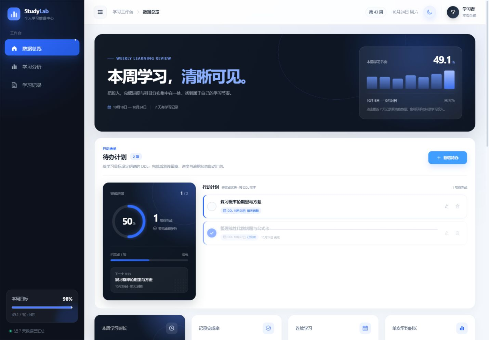

# 个人学习数据统计可视化看板

一个使用 **Vue 2.7 + Element UI + ECharts + CSS3** 构建的响应式学习看板。页面内置最近 7 天的演示数据，并支持手动管理学习记录与待办计划；学习记录、待办和主题设置均保存在当前浏览器中，不依赖后端。



夜间主题、移动端与录入抽屉：

- [夜间待办计划预览](docs/todo-planner-dark.png)
- [夜间桌面预览](docs/dashboard-dark-desktop.png)
- [日间移动端预览](docs/dashboard-mobile.png)
- [夜间移动端预览](docs/dashboard-mobile-dark.png)
- [夜间录入抽屉预览](docs/record-editor-dark.png)

## 技术栈

| 技术 | 版本 | 用途 |
| --- | --- | --- |
| Vue | 2.7.16 | 页面与组件状态管理 |
| Element UI | 2.15.14 | 侧栏、表格、分页、抽屉、表单、提示框 |
| ECharts | 5.6.0 | 折线图、环形饼图 |
| Vite | 5.4.21 | 本地开发与生产构建 |
| CSS3 | - | 响应式布局、主题变量、淡入与悬浮动画 |

## 启动方式

环境要求：Node.js 18 或更高版本。

在项目目录 `D:\github\study` 中执行：

```powershell
npm install
npm run dev
```

浏览器打开：

```text
http://127.0.0.1:5173
```

生产构建与本地预览：

```powershell
npm run build
npm run preview
```

预览地址默认为：

```text
http://127.0.0.1:4173
```

构建产物位于 `dist/`。

## 功能清单

### 看板与交互

- 左侧 `el-menu` 导航、顶部导航栏、右侧内容区组成的后台管理布局。
- 桌面端侧栏可折叠；宽度小于 960px 时自动切换为移动端抽屉菜单。
- 4 张概览卡片展示本周时长、完成率、连续学习天数和单次平均时长；悬浮时有放大与阴影反馈。
- 最近 7 天学习趋势折线图，包含日均参考线和当前联动日期竖线。
- 科目学习时长环形饼图，展示总时长、各科目时长与占比。
- 表格行与折线图双向联动；点击折线节点也会同步更新表格高亮日期。
- 页面装载、图表入场、区块切换均有淡入或过渡效果，并尊重 `prefers-reduced-motion`。

### 手动记录管理

- “学习记录”标题区提供“录入记录”主按钮，点击后打开右侧录入抽屉。
- 抽屉支持日期、科目、学习时长和完成状态；桌面宽 440px，小屏为全宽。
- 支持快捷时长 `0.5 / 1 / 1.5 / 2 小时`，状态使用三张可选状态卡。
- 科目使用 `el-select` 的 `filterable + allow-create`，输入新名称即可创建自定义科目。
- 自定义科目名称会去首尾空格，限制 1–20 字；与已有科目重名时直接复用原科目与配色。
- 日期选择器禁止选择未来日期；学习时长限制为 0.1–12 小时，步长 0.5。
- 最近 7 天以外的日期会显示非阻断提示，明确该记录只进入历史表格，不参与当前统计。
- 手动记录在表格中带“手动”标记，并提供“编辑 / 删除”操作；演示记录只读。
- 删除前使用 `el-message-box` 二次确认，按钮点击不会误触发表格行联动。
- 保存后自动翻页并短暂高亮对应记录；编辑保留原记录 ID；删除当前联动日期后回退到最新可用记录。

### 待办计划

- 待办计划位于“本周学习”主视觉与四张概览卡片之间，使用全宽面板承载完成进度、下一个 DDL 和行动计划。
- 支持新增、编辑、删除和恢复待办；输入内容去首尾空格，限制 1–60 字，DDL 通过 `el-date-picker` 选择。
- 表单提供“今天 / 明天 / 一周后”快捷日期，并通过展开、收起过渡与焦点反馈保持操作连续。
- 未完成项优先、按 DDL 升序排列；已完成项沉到列表底部，并按完成时间倒序排列。
- DDL 会显示“今天到期 / 明天到期 / 还剩 N 天 / 逾期 N 天”等相对状态；已完成项保留原截止日期。
- 完成待办后，标题横线从左向右扫过，整条记录透明度降低；再次点击可恢复待办。
- 新增、删除和重新排序使用 `transition-group` 位移动画，按钮、勾选框和卡片均包含悬浮、按下与键盘焦点反馈。
- 删除前使用 `el-message-box` 二次确认；空标题、缺失或非法截止日期会被表单校验拦截。
- 空列表、完成进度环、完成率和逾期统计均为响应式派生状态，不与学习时长统计混用。

### 主题与数据

- 头像左侧提供圆形日/夜间主题切换按钮，包含 `aria-label`、焦点态和悬浮反馈。
- 首次访问跟随系统 `prefers-color-scheme`，用户切换后以保存值为准。
- `index.html` 在 Vue 挂载前读取主题，避免刷新时出现亮色闪屏。
- 夜间主题使用深灰背景与抹茶绿强调色，并同步覆盖侧栏、顶栏、卡片、表格、分页、抽屉、输入框、日期面板、下拉浮层、消息框和确认弹窗。
- 折线图与饼图在主题变化后重新生成 ECharts option，使用抹茶绿曲线、面积和四档可区分科目色。
- 手动记录与自定义科目刷新后仍然存在；损坏或旧版本的本地数据会被逐字段校验，异常数据不会阻止页面加载。

## 数据与统计边界

表格展示演示数据与手动记录的完整合并列表，按日期、创建时间倒序排列。趋势折线图、饼图、完成率和概览卡片固定统计最近 7 天。

最近 7 天之外的记录只进入完整表格；点击这类历史记录时，表格会高亮，但折线图摘要会明确显示“范围外历史记录”，不会误选为最近一天。

手动记录结构如下：

```js
{
  id: 'manual-...',
  date: '2026-10-24',        // 浏览器本地 YYYY-MM-DD
  subject: '前端开发',
  hours: 1.5,
  status: '已完成',
  source: 'manual',
  createdAt: '2026-10-24T02:30:00.000Z',
  updatedAt: '2026-10-24T02:30:00.000Z'
}
```

本地存储键：

| 键 | 内容 |
| --- | --- |
| `studylab:data:v1` | `{ version: 1, records, customSubjects }` |
| `studylab:todos:v1` | `{ version: 1, todos }` |
| `studylab:theme:v1` | `light` 或 `dark` |

手动待办结构如下：

```js
{
  id: 'todo-...',
  title: '完成线性代数第三章习题',
  dueDate: '2026-10-28',     // 浏览器本地 YYYY-MM-DD
  completed: false,
  createdAt: '2026-10-24T03:20:00.000Z',
  updatedAt: '2026-10-24T03:20:00.000Z',
  completedAt: null
}
```

演示数据每天按浏览器本地日期动态生成，不写入本地存储；手动记录、自定义科目和待办会长期保留，直到用户清理浏览器数据。学习记录与待办使用独立存储键，任一模块保存时不会覆盖另一模块。

## 项目结构

```text
study/
├─ docs/                         # 日间、夜间、待办模块、移动端与录入抽屉预览图
├─ src/
│  ├─ components/
│  │  ├─ AppHeader.vue           # 顶部导航与主题切换
│  │  ├─ AppSidebar.vue          # 侧栏与 el-menu
│  │  ├─ StatCard.vue            # 概览卡片
│  │  ├─ StudyTrendChart.vue     # 7 天趋势折线图
│  │  ├─ SubjectPieChart.vue     # 科目占比环形图
│  │  ├─ RecordsTable.vue        # 表格、分页、行操作与自动定位
│  │  ├─ RecordEditorDrawer.vue  # 学习记录录入 / 编辑抽屉
│  │  └─ TodoPlanner.vue         # 待办新增、编辑、完成与删除
│  ├─ data/
│  │  ├─ studyData.js            # 演示数据、校验、汇总与派生逻辑
│  │  ├─ studyStorage.js         # 学习数据与主题的读取、清洗与保存
│  │  └─ todoStorage.js          # 待办读取、校验、排序与独立持久化
│  ├─ styles/global.css          # 主题变量、Element UI 暗色覆盖与公共样式
│  ├─ App.vue                    # 页面编排、统一数据操作与联动状态
│  └─ main.js                    # Vue / Element UI 入口
├─ index.html                    # 主题预加载与页面挂载点
├─ package.json
└─ vite.config.js
```

## 关键实现

### 单一数据源

`src/data/studyData.js` 的 `createDashboardSnapshot()` 接收演示记录、手动记录与科目列表，统一派生：

- 完整表格记录
- 最近 7 天每日趋势
- 科目占比
- 总时长、日均、完成率、学习天数和单科平均时长

新增、编辑或删除记录后，`App.vue` 只需更新原始记录，所有模块会基于同一份快照立即重算，避免统计口径不一致。

### 本地持久化与容错

`src/data/studyStorage.js` 对 `localStorage` 数据执行版本、日期、时长、状态、科目、重复 ID 和颜色字段校验。JSON 损坏、浏览器禁用存储或旧版本数据都会安全回退，不会导致白屏。

每次增删改后立即写入 `studylab:data:v1`；科目同时保存日间与夜间两套颜色，切换主题后饼图配色不会丢失。

### 表格与折线图联动

联动日期由 `App.vue` 的 `selectedDate` 统一管理：

1. 表格行触发 `select-date`，携带该行日期。
2. `handleSelectDate()` 更新共享日期。
3. 折线图重绘当前节点、竖线和摘要。
4. 表格通过 `row-class-name` 为同一天的所有记录添加高亮样式。

折线图节点点击也复用同一方法。范围外历史日期有独立的“范围外历史记录”状态，不会进入 7 天趋势统计。

### 待办排序与完成动画

`TodoPlanner.vue` 独立管理待办的增删改与完成状态，`todoStorage.js` 在读取时逐字段校验 ID、标题、DDL、布尔状态和时间戳。损坏的单条数据会被丢弃，旧版本或异常 JSON 会回退为空列表，不影响看板其他模块。

- 完成进度、剩余数、逾期数和下一个 DDL 都由当前待办数组即时派生。
- 状态变化后先重新排序再写入 `studylab:todos:v1`；`transition-group` 的 `move` 过渡负责平滑处理位置变化。
- 标题划线不依赖 `text-decoration`，而是通过 `background-size` 从 `0` 过渡到 `100% 1.5px`，因此横线可以连续扫过；完成记录同时以约 300ms 过渡降低透明度。
- 表单使用 `grid-template-rows: 0fr → 1fr` 展开，避免硬切；新增与删除行使用透明度、位移和缩放过渡。
- 所有动效都在 `prefers-reduced-motion: reduce` 下关闭位移与划线过渡，并保留完整的键盘焦点样式。

### 主题切换

主题由 `html[data-theme]` 和 CSS 变量驱动。`AppHeader` 发出 `toggle-theme`，`App.vue` 更新 `isDark`、同步 `color-scheme` 并写入本地存储；两张 ECharts 图通过 `isDark` 属性监听并重新渲染配置。

夜间主题在 `prefers-reduced-motion: no-preference` 下使用约 220ms 的颜色与阴影过渡；减少动态效果时不启用主题过渡。

### 响应式表格

- 1180px 以下图表改为单列；1040px 以下统计卡片改为两列；548px 以下改为单列。
- 960px 以下侧栏使用抽屉模式，打开时锁定背景滚动，并支持点击遮罩关闭。
- 680px 以下收敛列宽与单元格内边距；表格自身横向滚动，“操作”列始终固定在右侧。
- 分页在窄屏下切换为 `prev, pager, next` 布局，避免横向溢出。

## 校验与测试

建议按以下场景复测：

1. 新增最近 7 天记录，确认表格、折线图、饼图、完成率和概览卡片同步更新。
2. 编辑记录后保持原 ID，并确认保存后自动翻页定位与行高亮。
3. 删除记录前出现二次确认；删除当前联动日期后回退到最新可用记录。
4. 新增、编辑待办并选择 DDL，确认抽屉表单、列表、进度摘要和下一个 DDL 同步更新。
5. 刷新页面，确认手动学习记录、自定义科目、待办和主题仍然存在。
6. 切换待办完成状态，确认标题横线、透明度、排序位置和完成进度均有过渡动画。
7. 删除待办前确认弹窗出现，删除后列表、进度和本地存储同步更新。
8. 检查空标题、非法 DDL、空科目、未来学习日期与超范围时长等异常输入。
9. 在 1440px 与 390px 视口检查待办表单、日期面板、固定操作列、侧栏菜单和主题切换，确认无横向溢出。
10. 在日/夜间主题下检查待办卡片、Element UI 浮层和两张 ECharts 图。

最终执行：

```powershell
npm run build
```

## 已知边界

- 最近 7 天之外的记录只进入完整表格，不参与趋势、饼图和概览统计。
- 待办计划独立于学习记录统计，不折算为学习时长。
- 本项目不包含后端、账号同步、导入导出、备注字段或独立科目管理页。
- 手动记录可完整增删改，演示记录只读。
- Vue 2 已进入官方维护终止（EOL）阶段；如用于长期生产项目，建议后续迁移到 Vue 3 + Element Plus，并复刻现有数据层与交互。

## 依赖许可

Vue 为 MIT，Element UI 为 MIT，ECharts 为 Apache-2.0，Vite 为 MIT。项目未复制来源不明的第三方页面代码或素材。
